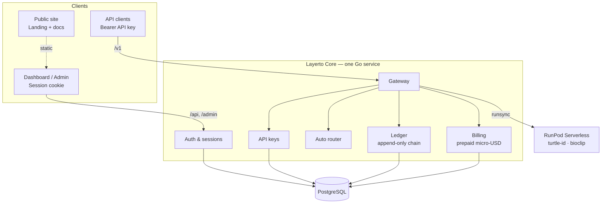
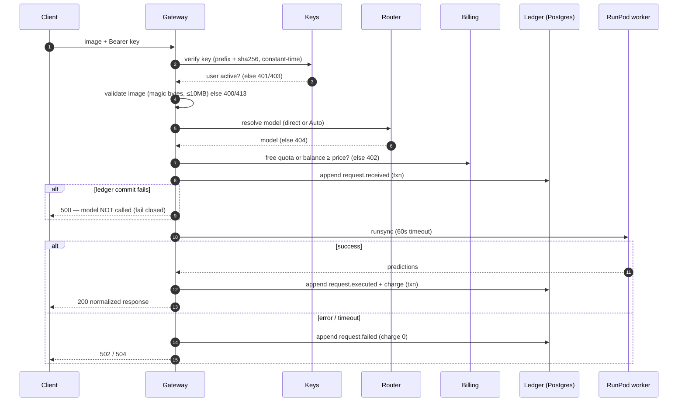
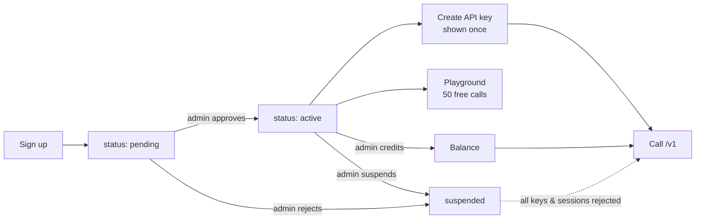
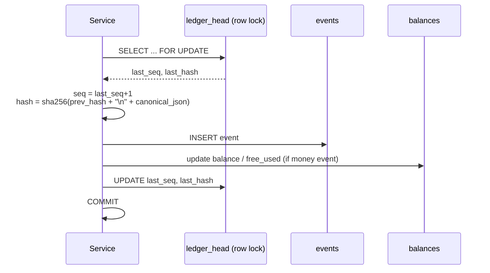
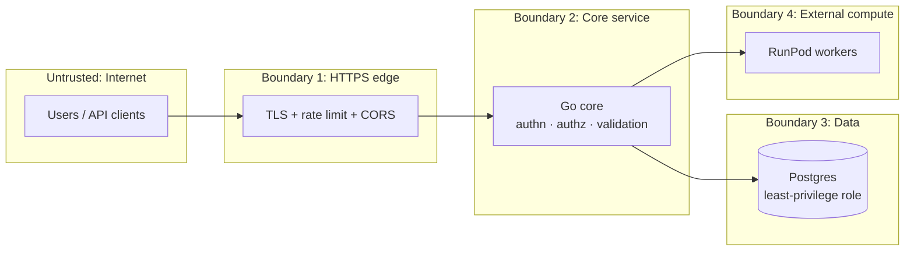

# Layerto v1 — System Design & Security

Companion to `SPEC.md`. Diagrams are Mermaid and render on GitHub.

---

## 1. System architecture

**Deployment (v1):** one VPS or container host runs `core` and Postgres, with static frontends served from a CDN/static host behind HTTPS. RunPod workers are reached only over HTTPS with the RunPod API key, which lives only on the core server.

---

## 2. Vision request flow (`POST /v1/vision/{slug|auto}`)

---

## 3. Account lifecycle flow

---

## 4. Ledger append (inside one DB transaction)

---

## 5. Security design

### 5.1 Trust boundaries

Rule: nothing crosses a boundary without being authenticated, validated and logged.

### 5.2 Threat model (v1)

| # | Threat | Where | Control |
|---|---|---|---|
| T1 | Stolen / leaked API key | Client | Keys hashed (sha256), shown once, revocable, prefix visible for identification; per-key rate limit; `last_used_at` shown in dashboard |
| T2 | Brute-force login | `/api/auth/login` | argon2id; 5 failed attempts per IP+email per 15 min → 429; generic error message |
| T3 | Session hijack / CSRF | Dashboard | HttpOnly + Secure + SameSite=Lax cookie; `Origin` check + `X-Requested-With` on mutations; session rotation on login; logout deletes the server-side session |
| T4 | Malicious image upload | `/v1`, playground | Magic-byte MIME check, 10 MB cap, decoded-dimension cap (e.g. 8000×8000) to stop decompression bombs; images never written to disk/DB |
| T5 | Free-tier abuse (many accounts) | Signup | Admin approval gate; free quota is per account; one key namespace per user |
| T6 | Billing fraud / race (double-spend) | Billing | Balance check + charge inside the ledger transaction with a row lock; integer micro-USD only |
| T7 | Ledger tampering | Postgres | Append-only trigger blocks UPDATE/DELETE; app DB role has INSERT/SELECT only on `events`; hash chain + `/admin/ledger/verify`; daily export of `last_hash` to an external location (signed checkpoint, v1.1) |
| T8 | Privilege escalation to admin | `/admin/*` | Role check middleware on every admin route; admins created only via the CLI; admin actions are ledger events |
| T9 | SQL injection | All | sqlc-generated parameterized queries only; no string-built SQL |
| T10 | Secret leakage | Repo / logs | All secrets in env; `.env` in `.gitignore`; never log keys, cookies, image bytes or password hashes; redact `Authorization` header in logs |
| T11 | RunPod key misuse | Core server | Key only on the server; never sent to browsers; rotate on suspicion; separate endpoints per model |
| T12 | Worker returns malicious/oversized output | Gateway | Schema-validate worker JSON, cap response size, strip unknown fields before returning |
| T13 | DoS / cost exhaustion | `/v1` | Per-key token bucket (60/min), global concurrency limit to RunPod, 60 s timeout, request body limit |
| T14 | Account enumeration | Signup / login | Same response for unknown email and wrong password |
| T15 | Data privacy | Whole system | Store only image hash/size/MIME; no prompts with PII required; publish a short privacy page stating images are not stored |

### 5.3 Security controls by layer

**Edge**
- HTTPS everywhere (HSTS); HTTP redirects to HTTPS.
- CORS: `/api` and `/admin` allow only the dashboard/admin origins; `/v1` allows any origin but requires a key.
- Request body limit: 12 MB.
- Security headers on the frontends: CSP, `X-Content-Type-Options: nosniff`, `Referrer-Policy: strict-origin-when-cross-origin`, `frame-ancestors 'none'`.

**Application**
- Middleware order: request ID → recover → body limit → rate limit → auth → role check → handler.
- Every handler validates input before any side effect.
- Errors use the standard JSON envelope, with no stack traces in responses.
- Constant-time comparisons for key hashes.

**Data**
- Two DB roles: `layerto_migrator` (DDL, used only by goose) and `layerto_app` (DML, with no UPDATE/DELETE on `events`).
- Postgres is not exposed publicly (localhost or private network only).
- Daily encrypted backups, plus a monthly restore test.

**Operations**
- Structured JSON logs with `request_id`; secrets are redacted.
- Alerts: ledger verify failure, 5xx spike, RunPod error rate, admin login.
- Dependency scanning: `govulncheck` for Go, `pnpm audit` for JS, run in CI.
- Key rotation procedure documented for: RunPod key, DB passwords, session secret.

### 5.4 Security tests (must exist before launch)

- Ledger: chain verifies; a manual UPDATE attempt is rejected by the trigger; a tampered row is detected by verify.
- Keys: revoked key → 401; suspended user's key → 403; wrong secret with a valid prefix → 401.
- Billing: concurrent calls can't overspend; a failed call isn't charged; free quota stops at 50.
- Upload: a non-image file renamed `.jpg` → 400; oversized → 413; huge dimensions → 400.
- Auth: login rate limit triggers; a CSRF request without `Origin` is rejected.
- Admin: a user-role session hitting `/admin/*` → 403.

### 5.5 Deferred to v1.1+

- Signed ledger checkpoints stored outside the DB (for example, published daily).
- Email verification and 2FA for admin.
- Per-key scopes (restrict a key to specific models).
- WAF / bot protection on signup.
- Formal privacy policy and terms of service.
